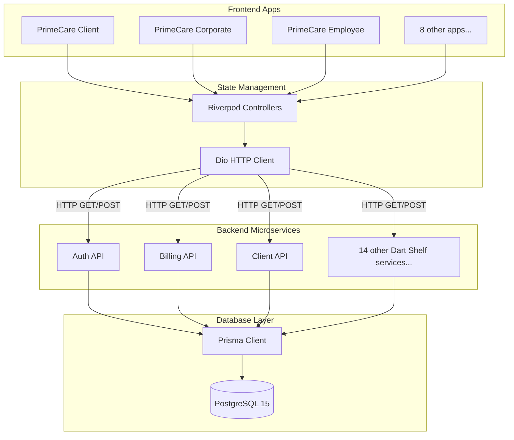

# PrimeCare Enterprise Platform

Foreground internal browser calling is deployed and live-verified for users with existing communication access. It reuses the inherited call/media core, native PostgreSQL extensions and Cloudflare TURN; internal calls do not require Twilio. Both call directions, call back, mute/end, access denial and session-revocation cleanup passed. Keep the Calls page open. Initial connection setup remains slow (about 53 seconds in the final test). Latency research now measures individual native request durations and separates first connection from the later packet-growth check. A tested startup optimization removes an inbox wait and one adjacent duplicate read; Smart Placement and the startup changes passed live calling at 40.1 seconds, so performance remains unresolved. The cache-disabled Hyperdrive read transport is deployed with the same pinned origin, native advisory-lock transactions and aggregate query timings. Startup now uses server-issued version hints for optimistic commands, rereading only on explicit conflicts; current server authorization remains mandatory. Updated live latency verification is pending. No authorization results are cached and no one-second live result is claimed. See the [calling guide and evidence](docs/business/calling-live-readiness-20261025.md).

Voiceprint recognition checkpoint (25 October 2026): the shared scoped voiceprint service/channel and inherited Aculab provider resource implement enrollment, speaker matching with presentation-attack rejection, and revocation/deletion reporting. Provider responses are stubbed in automated tests; live biometrics, real-speaker accuracy and appointment authorization by voiceprint remain unverified. See [voiceprint recognition](docs/business/voiceprint-recognition-20261025.md).

Phone-only call authorization (25 October 2026): shared inherited services now support registered-contact OTP via private keypad entry, exact appointment readback, and one-use signed spoken/keypad confirmation. `PhoneCallOperationCore` composes the same task service for Twilio and Vapi. This is an internal implementation with candidate schema; production registration, deployment and live verification remain pending. See [phone-only authorization](docs/business/phone-call-authorization-20261025.md).

SMS link runtime checkpoint (25 October 2026): the inherited native service/channel and bounded HTTP adapter now implement the three registered owner contracts with private output projection and repeated native session/API permission checks. Status verifies current session and conversation access; bind/revoke retain fresh-session repository enforcement. Runtime host mounting, access grants and live SMS remain pending. See [native SMS link runtime](docs/business/sms-link-native-runtime-20261025.md).

[](https://github.com/shaikhrais/primecare-platform/actions)
[](https://flutter.dev)
[](https://dart.dev)
[](https://www.prisma.io)

Welcome to the **PrimeCare Enterprise Platform**! This is a massive, highly-scalable monorepo housing 11 Flutter applications, 17 Full-Stack Dart microservices, and a PostgreSQL database synchronized via Prisma.

---

## 🏛️ Architecture Overview

The platform uses a unified language ecosystem (Dart) across both the frontend and the backend.



### Key Technologies
- **UI Framework:** Flutter
- **State Management:** Riverpod (`ConsumerWidget`)
- **Backend Framework:** Dart Shelf (`shelf_router`)
- **Networking:** Dio
- **Database ORM:** Prisma
- **Orchestration:** Docker Compose

---

## 🚀 Quick Start Guide

### Prerequisites
- Install [Docker Desktop](https://www.docker.com/products/docker-desktop/)
- Install [Flutter SDK](https://docs.flutter.dev/get-started/install)
- Install [Node.js](https://nodejs.org/) (for Prisma tooling)

### 1. Boot up the Backend Infrastructure
We have fully Dockerized the 17 microservices and the PostgreSQL database. Open your terminal at the root of the project and run:

```bash
docker-compose up --build -d
```
*This spins up the database on port `5432` and all 17 microservices sequentially from ports `3001` to `3017`.*

### 2. Synchronize the Database
Ensure your PostgreSQL database is fully hydrated with our modular schema logic:

```bash
cd packages/database
npm install
npm run db-sync
```

### 3. Run a Flutter App
Navigate to any of the 11 apps and launch it:

```bash
cd apps/primecare_client
flutter run
```

---

## 🛠️ Monorepo Structure

- `/apps/` - The 11 Flutter frontend applications.
- `/services/` - The 17 Full-Stack Dart backend microservices.
- `/packages/database/` - Centralized Prisma schemas and database configurations.
- `/scripts/` - Automated DevOps and Code Generation scripts.

---

## 🤝 Contributing
Please see the [CONTRIBUTING.md](./CONTRIBUTING.md) guide for detailed instructions on how to add new Riverpod controllers, Prisma schemas, and Backend Routes.

## 📄 License
Proprietary & Confidential. All rights reserved by PrimeCare.
