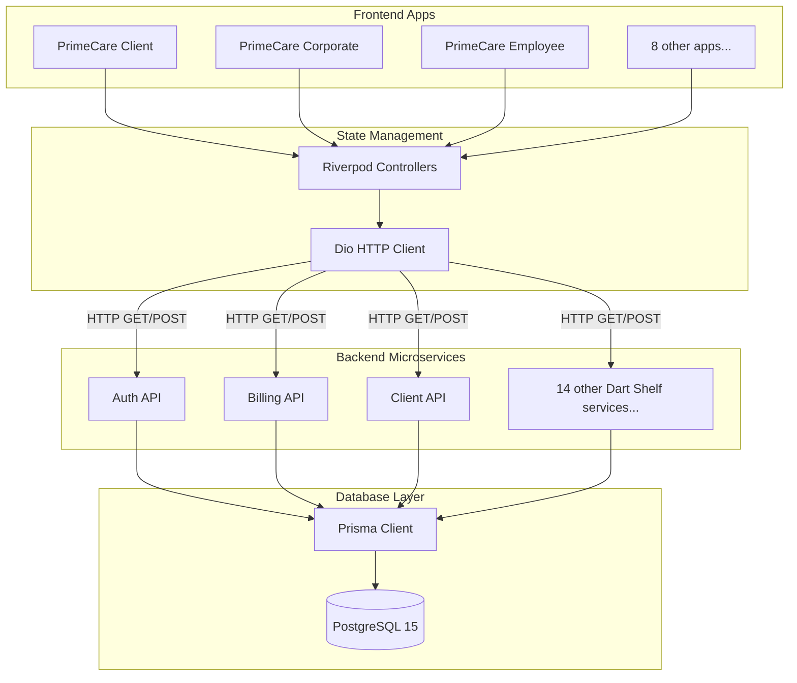

# PrimeCare Enterprise Platform

Foreground internal browser calling is deployed and live-verified for users with existing communication access in the same tenant. It reuses the inherited call/media core, native PostgreSQL extensions and Cloudflare TURN; internal calls do not require Twilio. Keep the Calls page open. Five production permission indexes and native numeric joins reduced the permission query from 233.5 ms to 1.1 ms. Both relay peers now connect silently while ringing. A recorded production answer-to-audio result was 5.047 seconds, following 7.071-second pooled preparation and 10.040-second authenticated-push results; the one-second target remains unmet. Both call directions, call back, mute/end, access denial and session-revocation cleanup passed. See the [calling guide and evidence](docs/business/calling-live-readiness-20261025.md).

Call latency improvement in this change: one parameterized PostgreSQL query combines current session, API/screen grants, manifest, scoped policy documents, active participants and selected call state into one read-only snapshot. The inherited calling service uses a fresh snapshot at every authorization boundary; atomic writes retain native advisory locks, version checks and idempotency. The hosted database rejects stored-function creation; the same generated SQL runs as one query without requiring added privileges. The optional function is fixture-tested, and the production workflow reruns the live two-browser call test. All 17 calling workflow jobs passed, including live audio in both directions. Typical call-read SQL statements fell from 26 to 4, and media requests from 56 to 8; call writes retain their native transactions.

Authenticated call-push implementation: a per-user Cloudflare Durable Object accepts a bounded first-frame native session authentication, checks current command and events API/screen grants, and pushes only call-change/signal invalidations after committed updates. Browsers fetch private state through the existing authorized APIs. The inbox uses a ten-second recovery poll while connected, and existing one-second audio checks preserve session-revocation cleanup. Production registration, deployment and all 17 calling jobs passed. Both live peers received authenticated change and signal pushes. This earlier push-only checkpoint observed 10.040 seconds; the silent-transport checkpoint below is the current result.

Ringing media preparation is deployed and live-verified in source `bcc701eeb6b8f005487f639d15a0ce42236fceb4`. Both peers establish their relay transport before Answer with zero microphone tracks. A separate registered preparation-signal contract reuses the inherited scoped signal transition; the original signaling endpoint stays accepted-only. Current command/media/preparation API and screen grants and active participants are checked without an authorization cache. Tracks remain disabled until a fresh post-capture accepted-call read, and the negotiated sender is reused. Acceptance initializes its presence lease atomically. All 17 calling jobs passed, including both call directions, mute/end, tenant denial and session-revocation cleanup. The local real-Chromium transport test took 352 ms after acceptance, while the actual authenticated production call took 5.047 seconds. The acceptance request alone took 2.030 seconds, so one-second production calling is not verified. See the [current preparation evidence](reports/communications/internal-calling-preparation-performance-20261025.json).

External staff-to-client telephone calling is deployed and ready for a user-selected phone test. The current mobile dial pad is source `6fbaf5782db503d9a2b86d935549b0ffae9a7edb`; the initial backend release was `6bf5689cf6adda3ae85143372d2f8dc04c436785`. Current scoped checks cover native PostgreSQL, Workerd, browser controls and production staff/Code Admin login. In **Calls → Call a client’s phone**, enter the country-code number and click **Call phone**. Calls use the verified platform caller ID +1 647 930 2223. Current session/API/screen grants and an opaque one-use reservation protect the shared scoped service; client and patient roles cannot dial, including when a patient accidentally receives an API grant. Token renewal, mute/hangup and local permission-revocation cleanup are implemented. The dedicated outbound TwiML application and encrypted bindings use GitHub production secrets without an AI-model dependency or incoming-number routing change. No real handset call or 100-call load test was performed by automation. See the [external-calling test guide](docs/business/external-calling-20261026.md) and [deployment receipts](reports/communications/external-calling-deployment-20261026.json).

Voiceprint recognition checkpoint (25 October 2026): the shared scoped voiceprint service/channel and inherited Aculab provider resource implement enrollment, speaker matching with presentation-attack rejection, and revocation/deletion reporting. Provider responses are stubbed in automated tests; live biometrics, real-speaker accuracy and appointment authorization by voiceprint remain unverified. See [voiceprint recognition](docs/business/voiceprint-recognition-20261025.md).

Phone-only call authorization (25 October 2026): shared inherited services now support registered-contact OTP via private keypad entry, exact appointment readback, and one-use signed spoken/keypad confirmation. `PhoneCallOperationCore` composes the same task service for Twilio and Vapi. This is an internal implementation with candidate schema; production registration, deployment and live verification remain pending. See [phone-only authorization](docs/business/phone-call-authorization-20261025.md).

SMS link runtime checkpoint (25 October 2026): the inherited native service/channel and bounded HTTP adapter now implement the three registered owner contracts with private output projection and repeated native session/API permission checks. Status verifies current session and conversation access; bind/revoke retain fresh-session repository enforcement. Runtime host mounting, access grants and live SMS remain pending. See [native SMS link runtime](docs/business/sms-link-native-runtime-20261025.md).

[](https://github.com/shaikhrais/primecare-platform/actions)
[](https://flutter.dev)
[](https://dart.dev)
[](https://www.prisma.io)

Welcome to the **PrimeCare Enterprise Platform**! This is a massive, highly-scalable monorepo housing 11 Flutter applications, 17 Full-Stack Dart microservices, and a PostgreSQL database synchronized via Prisma.

---

## 🏛️ Architecture Overview

The platform uses a unified language ecosystem (Dart) across both the frontend and the backend.



### Key Technologies
- **UI Framework:** Flutter
- **State Management:** Riverpod (`ConsumerWidget`)
- **Backend Framework:** Dart Shelf (`shelf_router`)
- **Networking:** Dio
- **Database ORM:** Prisma
- **Orchestration:** Docker Compose

---

## 🚀 Quick Start Guide

### Prerequisites
- Install [Docker Desktop](https://www.docker.com/products/docker-desktop/)
- Install [Flutter SDK](https://docs.flutter.dev/get-started/install)
- Install [Node.js](https://nodejs.org/) (for Prisma tooling)

### 1. Boot up the Backend Infrastructure
We have fully Dockerized the 17 microservices and the PostgreSQL database. Open your terminal at the root of the project and run:

```bash
docker-compose up --build -d
```
*This spins up the database on port `5432` and all 17 microservices sequentially from ports `3001` to `3017`.*

### 2. Synchronize the Database
Ensure your PostgreSQL database is fully hydrated with our modular schema logic:

```bash
cd packages/database
npm install
npm run db-sync
```

### 3. Run a Flutter App
Navigate to any of the 11 apps and launch it:

```bash
cd apps/primecare_client
flutter run
```

---

## 🛠️ Monorepo Structure

- `/apps/` - The 11 Flutter frontend applications.
- `/services/` - The 17 Full-Stack Dart backend microservices.
- `/packages/database/` - Centralized Prisma schemas and database configurations.
- `/scripts/` - Automated DevOps and Code Generation scripts.

---

## 🤝 Contributing
Please see the [CONTRIBUTING.md](./CONTRIBUTING.md) guide for detailed instructions on how to add new Riverpod controllers, Prisma schemas, and Backend Routes.

## 📄 License
Proprietary & Confidential. All rights reserved by PrimeCare.

### Native Android calling test APK

[PrimeCare Calls](mobile/primecare-call-android/README.md) uses native Android
sign-in/MFA and Twilio’s Android Voice SDK. No Chrome, browser or WebView is
required. The calling APK workflow builds, tests, lints and signs the sideload
test app. It reuses current registered auth and external-call APIs and uses a
microphone foreground service for active calls. This supersedes the earlier
Chrome-powered launcher. Real handset/PSTN audio remains a user test.

### Master tenant and Code Admin phone calling

The existing registered Code Admin control tenant is reused as the master;
`platform_master_tenant` links its current owner and `tenant_parent_links` gives
every other tenant that parent. A native insert trigger also links future
tenants. Hierarchy does not widen tenant data permissions or move accounts.
The protected external-calling workflow registers the requirement, tests native
text/UUID identities, applies the exact hierarchy, and independently reads it
back. Edited roots, triggers, policies and explicit access denials are preserved.

Code Admin's existing Platform Administration screen hosts the shared phone dial
pad under **Calls** after current native API/screen grants succeed. The selected
child tenant never overrides the caller's account scope. External phone calls
are staff-only; clients, patients and guests cannot dial even if an accidental
API grant is present. Current clinical messaging rights are not expanded. Tests
include a synthetic production Code Admin login/MFA and dial-pad visibility;
automation never places a real phone call.

The master/staff-calling change first shipped from
`fe0d3928bd050d39fc4a9ed421280875e41164a4`: all 15 external-call jobs and
17 internal-call regression jobs passed. Synthetic production Code Admin login
with MFA verified **Platform Administration → Calls** and an enabled dial pad,
with zero real phone calls. See the [guide](docs/business/master-tenant-staff-calling-20261026.md)
and [receipts](reports/communications/master-tenant-staff-calling-20261026.json).

The shared phone dial pad now uses a responsive card, larger touch controls,
server-provided caller ID and visible call states. The phone field locks while
calling, and the mute indicator resets between calls. Real-browser fixture
checks cover 320–1280 px widths, overflow, touch targets and call cleanup without
placing provider calls. Existing native permissions and phone routing are reused.

Mobile UI deployment `6fbaf5782db503d9a2b86d935549b0ffae9a7edb` passed all
15 scoped calling jobs, including production staff and Code Admin/MFA dial-pad
checks. See [current UI receipts](reports/communications/calling-ui-20261026.json).
No real phone call was placed by automation.

### PWA installation and microphone access

Each portal publishes a standalone web app manifest, 192/512 px maskable-safe
PNG icons, an **Install PrimeCare** action and a network-only service worker.
The install action uses Chrome’s native prompt when available and otherwise
shows the Chrome menu path. Installation promotion remains browser-controlled;
installed standalone windows hide the action. Authentication pages, APIs,
tokens and private records are never cached by this worker. Offline navigation
shows a reconnect message and cannot replay an authenticated page.

The shared phone panel has **Enable microphone** and also checks permission
before preparing a call. Only an explicit user action requests audio; probe
tracks stop immediately. Permission denial gives Chrome/Android settings
instructions and cannot reserve or dial a call. Already-granted permission may
not display another browser prompt. Installation does not enable offline or
background phone calls, and role/session authorization is unchanged.
