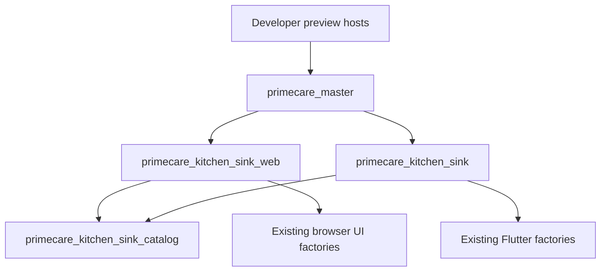

# PrimeCare package structure

This is the current committed package naming scheme with the new kitchen-sink packages added. Existing names and implementations are retained. Source-only entries are not automatically buildable or deployed services.

## Public entry and private ownership

Hosts import the master. The master re-exports the canonical package APIs, keeping class names, methods, aliases and type identity unchanged. Private implementations keep their existing declared dependencies and never import the master back.

| Public use | Entry |
|---|---|
| JavaScript composition | `@primecare/master` |
| Generated source package graph | `@primecare/master/catalog` |
| Browser kitchen sink | `@primecare/master/kitchen-sink` |
| Browser styles and canonical theme | `@primecare/master/kitchen-sink.css`, `@primecare/master/kitchen-sink-theme.css` |
| Flutter kitchen sink | `package:primecare_master/kitchen_sink.dart` |
| Dart composition source | `package:primecare_master/primecare_master.dart` |

The new Dart master manifest is a Flutter developer profile. This does not complete migration of the existing native apps or Dart service hosts. Their full headless/server profile integration remains separate. Browser API gateways and production business routes are unchanged by these developer packages.

## Source packages

44 source directories are recorded under `packages/`, including 41 manifest-bearing packages and three source-only directories. The table describes ownership, not production acceptance.

| Package | Responsibility | Declared package dependencies |
|---|---|---|
| `contracts` | Shared API contracts | `database` |
| `database` | TypeScript database schema and utilities | — |
| `database_client` | Dart database adapter | — |
| `domain` | Business and presentation contracts | `database` |
| `factory_system` | Existing factory definitions | — |
| `flutter_core` | Legacy Flutter implementations and compatibility exports | `primecare_assets`, `primecare_component_factory`, `primecare_dashboard_native`, `primecare_data_controls`, `primecare_help_reader`, `primecare_layout`, `primecare_models`, `primecare_navigation`, `primecare_page_templates`, `primecare_shell_utilities`, `primecare_ui_foundation`, `primecare_preferences`, `primecare_theme`, `primecare_work_contracts`, `primecare_application_shortcuts`, `primecare_task_port`, `primecare_profile`, `primecare_work_modules` |
| `infrastructure` | Infrastructure adapters | `database` |
| `messaging` | Communication adapters | `database` |
| `primecare_kitchen_sink` | Flutter showcase using existing factories | `primecare_assets`, `primecare_component_factory`, `primecare_dashboard`, `primecare_data_controls`, `primecare_kitchen_sink_catalog`, `primecare_theme`, `primecare_ui_foundation` |
| `primecare_kitchen_sink_catalog` | New generated stories, labels and reference inventory | — |
| `primecare_kitchen_sink_web` | Browser showcase using existing factories | `domain`, `primecare_assets_web`, `primecare_component_factory_web`, `primecare_dashboard`, `primecare_data_controls_web`, `primecare_kitchen_sink_catalog`, `primecare_package_base`, `primecare_pagination`, `primecare_samples` |
| `primecare_master` | Sole public PrimeCare entry and compatibility gateways | `contracts`, `database`, `domain`, `infrastructure`, `messaging`, `primecare_assets`, `primecare_assets_web`, `primecare_component_factory`, `primecare_component_factory_web`, `primecare_dashboard`, `primecare_data_controls`, `primecare_help_reader`, `primecare_data_controls_web`, `primecare_demo`, `primecare_kitchen_sink`, `primecare_kitchen_sink_catalog`, `primecare_kitchen_sink_web`, `primecare_layout`, `primecare_navigation`, `primecare_page_templates`, `primecare_shell_utilities`, `primecare_navigation_web`, `primecare_package_base`, `primecare_pagination`, `primecare_samples`, `primecare_ui`, `security`, `shared`, `primecare_preferences`, `primecare_theme`, `primecare_work_contracts`, `primecare_application_shortcuts`, `primecare_task_port`, `primecare_profile`, `primecare_work_modules` |
| `primecare_theme` | Native theme models, presets, semantic colors and ThemeData composition | `primecare_layout`, `primecare_navigation`, `primecare_ui_foundation` |
| `primecare_preferences` | Native preference protocol, cache and transport | `primecare_layout`, `primecare_theme` |
| `primecare_models` | Canonical Dart models | — |
| `primecare_package_base` | Composition registry, dependency impact and composition status | — |
| `primecare_assets` | Canonical Flutter original asset rendering and generated asset data | — |
| `primecare_assets_web` | Web original asset facade | `primecare_ui` |
| `primecare_component_factory` | Canonical Flutter component factory, models and tests | `primecare_ui_foundation` |
| `primecare_component_factory_web` | Web component factory facade | `primecare_ui` |
| `primecare_data_controls` | Canonical Flutter table, field, rich editor and upload controls | `primecare_assets`, `primecare_component_factory`, `primecare_ui_foundation` |
| `primecare_data_controls_web` | Web data controls facade | `primecare_ui` |
| `primecare_navigation` | Canonical Flutter workspace navigation renderer and model | `primecare_assets`, `primecare_layout`, `primecare_ui_foundation` |
| `primecare_navigation_web` | Web workspace navigation facade | `primecare_ui` |
| `primecare_layout` | Native workspace layout models, controller, preferences and file adapter | — |
| `primecare_dashboard` | Cross-platform dashboard presentation facade | `domain`, `primecare_dashboard_native`, `primecare_ui` |
| `primecare_dashboard_native` | Canonical native dashboard widgets, chart models and preference sessions | `primecare_component_factory`, `primecare_preferences`, `primecare_ui_foundation` |
| `primecare_work_contracts` | Native work records, commands, ports and session contracts | `primecare_preferences` |
| `primecare_application_shortcuts` | Native shortcut settings, picker and explicit recovery | `primecare_component_factory`, `primecare_preferences`, `primecare_shell_utilities`, `primecare_ui_foundation`, `primecare_work_contracts` |
| `primecare_task_port` | Tenant task work adapter and HTTP transport | `primecare_preferences`, `primecare_work_contracts` |
| `primecare_profile` | Authenticated self-profile read projection | `primecare_preferences`, `primecare_work_contracts` |
| `primecare_work_modules` | Native shared work renderer for calendars, tasks, contacts, notes and boards | `primecare_component_factory`, `primecare_data_controls`, `primecare_preferences`, `primecare_ui_foundation`, `primecare_work_contracts` |
| `primecare_shell_utilities` | Canonical native quick panel, favourites, registered actions and shell utility models | `primecare_preferences`, `primecare_ui_foundation` |
| `primecare_page_templates` | Canonical native route-layout model and responsive page templates | `primecare_navigation`, `primecare_ui_foundation` |
| `primecare_help_reader` | Canonical native Help reader client, controller and view | `primecare_component_factory`, `primecare_preferences`, `primecare_theme`, `primecare_ui_foundation` |
| `primecare_demo` | Source-owned synthetic demo row and chart fixtures | — |
| `primecare_samples` | Reusable component sample configurations | `primecare_demo` |
| `primecare_pagination` | Pure, immutable paging range and navigation state for Fuse-inspired controls | — |
| `primecare_ui` | Shared public UI exports and canonical browser implementations | `flutter_core`, `primecare_models`, `primecare_ui_foundation` |
| `primecare_ui_foundation` | Shared Flutter Material primitives | — |
| `security` | Security adapters | `database` |
| `server_core` | Dart service lifecycle and route foundations | `primecare_models` |
| `shared` | Shared browser/server contracts and state protocols | — |
| `worker-api` | Existing worker source package | — |

These graph edges come from manifests. Browser UI files currently belong to the `primecare_ui` source tree; private showcase imports retain that physical owner rather than copying its implementation. This is a private monorepo build, not a standalone npm publication.

## Service hosts

13 existing service host directories are recorded in the source catalog. Their presence is not proof of implemented remote APIs or a completed server migration.

| Host | Path | Hosting contract |
|---|---|---|
| `api_gateway` | `services/api_gateway` | `explicit-adapter-required` |
| `auth_api` | `services/auth_api` | `explicit-adapter-required` |
| `billing_api` | `services/billing_api` | `explicit-adapter-required` |
| `client_api` | `services/client_api` | `explicit-adapter-required` |
| `compliance_api` | `services/compliance_api` | `explicit-adapter-required` |
| `franchise_reporting_api` | `services/franchise_reporting_api` | `explicit-adapter-required` |
| `governance_api` | `services/governance_api` | `explicit-adapter-required` |
| `notes_api` | `services/notes_api` | `explicit-adapter-required` |
| `notification_api` | `services/notification_api` | `explicit-adapter-required` |
| `provider_api` | `services/provider_api` | `explicit-adapter-required` |
| `scheduling_api` | `services/scheduling_api` | `explicit-adapter-required` |
| `verification_api` | `services/verification_api` | `explicit-adapter-required` |
| `visit_api` | `services/visit_api` | `explicit-adapter-required` |

## Kitchen-sink package responsibilities

| Package | Owns | Does not duplicate |
|---|---|---|
| `primecare_kitchen_sink_catalog` | 36 story descriptors, EN/FR/ES preview labels, existing control snapshots and 72 source-audited reference entries; generated Dart/JSON views | Component implementations, roles or grants |
| `primecare_kitchen_sink_web` | Browser gallery, filters, package-impact preview and canonical examples | Component implementations, business data or grants |
| `primecare_kitchen_sink` | Flutter component gallery and theme demonstration | Canonical widgets, business routes or permissions |

The 72 reference entries retain their historical proposal dispositions and audited mapping scopes. A working component example does not close full application, backend, authority, accessibility, device or business acceptance. No Fuse vendor source is copied.

## Preview and verification

- Web build: `node tools/kitchen_sink/build.mjs`.
- Web output: `packages/primecare_kitchen_sink_web/dist/index.html` (serve the directory over HTTP).
- Flutter host: `examples/kitchen_sink_flutter`; its internal dependency is only `primecare_master`.
- Generated catalog check: `python tools/kitchen_sink/generate.py --check`.
- Master import boundary: `node tools/package_master/web_boundary.mjs`.
- CI: `.github/workflows/kitchen-sink-packages.yml` builds both previews and runs browser/widget checks. It has no deployment job or production secrets.

Local browser execution requires a host that supports Chromium's Unix socket/process sandbox. A failed launch is not a failed application assertion. Browser verification runs on the prescribed GitHub Actions host when this workspace cannot launch it.

## Package management and independent controls

Use `PackageCatalog.impact(changedIds)` for the declared reverse dependency closure in build order and `PackageMaster.status()` for local composition status. These are not deployment or runtime health evidence. The pagination package is available as `paginationState` and `movePagination` from `@primecare/master`. It accepts page, page size and an already-authorized total, clamps a stale page after the result count changes, and returns immutable view state. It does not fetch records. Existing portal controls are unchanged pending an independent integration and release review.

The browser kitchen-sink now consumes the independent demo and samples packages through its declared lower-level dependencies. External hosts consume demos and samples via the master root, or dashboard presentation via @primecare/master/dashboard. The dashboard facade forwards the original implementation; it does not migrate live business dashboard ownership yet.

The next cross-platform facade group uses existing canonical implementations: primecare_component_factory, primecare_data_controls, primecare_assets, and primecare_navigation. primecare_dashboard now also exposes its Dart implementation. External Dart and TypeScript hosts use the master scoped entries; private gallery imports its lower-level dependencies. This is an incremental facade migration, not deletion of flutter_core or primecare_ui.

The native component factory implementation and its native tests are now owned by primecare_component_factory. The former flutter_core/component_catalogue source paths contain temporary export-only compatibility files. The web facade is separate to keep the dependency graph acyclic across platform implementations. No production publish is part of this transfer.

Native original assets and data controls now own their implementations, model fixtures and tests. The original asset generator writes directly to the named owner. Old core paths remain temporary exports, and the web facades are separate to avoid mixed-language graph cycles.

Workspace model ownership is independent of core; the old renderer and scroll header remain in core until legacy production navbar registration is separated into an explicit release. Navigation uses the new named layout/model and asset packages.

Native theme model and preference protocol ownership now lives in the named packages. Legacy core paths temporarily export their canonical implementations for existing callers. Theme renderer and navbar registration paths are unchanged.

Native chart and dashboard widget implementations, tests and fixture now belong to `primecare_dashboard_native`. The cross-platform dashboard facade keeps the existing master entry points while avoiding a native/web dependency cycle.

The native theme builder, contrast helpers, semantic palette and application theme now belong to `primecare_theme`. The Flutter kitchen sink consumes the named owners directly and no longer declares Flutter Core.

The native Help reader is now owned by `primecare_help_reader`, accessed via `package:primecare_master/help_reader.dart`. Its three implementation files and three tests are physically relocated; advanced theme region and color codec are owned by `primecare_theme`. No screen, role or production registration changed.

Page template models and renderer, three standalone tests now belong to `primecare_page_templates`; the 288-case web fixture generator writes directly to that owner; the remaining cross-package workspace test stays with the legacy renderer until it is separately migrated.

Native shell utility model, controller, renderer and two test files are now owned by `primecare_shell_utilities`; the master provides the scoped `shell_utilities.dart` entry. Existing host and API authority remain unchanged.

Native work module contracts and application shortcuts now have canonical owners (primecare_work_contracts, primecare_application_shortcuts) and scoped master entries. Five implementation files, two tests, and the settings oracle were relocated. Legacy host integration remains in Flutter Core until the host uses master directly.

Native task transport and adapter are now owned by `primecare_task_port`; the self-profile port and its unit test are owned by `primecare_profile`. Integrated task tests remain in the legacy host suite until its renderer and workflows migrate. No change to authority or business routes.

The shared work module renderer and its widget/session test are owned by `primecare_work_modules`; master exports the renderer and named task adapter from `work_modules.dart`. Fifteen source mappings follow the exact compatibility chain, with no new acceptance or route authority.
