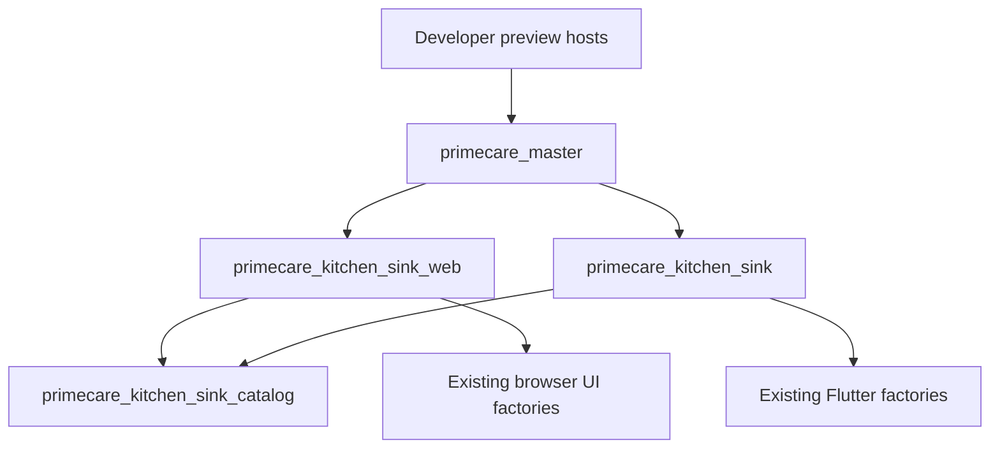

# PrimeCare package structure

This is the current committed package naming scheme with the new kitchen-sink packages added. Existing names and implementations are retained. Source-only entries are not automatically buildable or deployed services.

## Public entry and private ownership

Hosts import the master. The master re-exports the canonical package APIs, keeping class names, methods, aliases and type identity unchanged. Private implementations keep their existing declared dependencies and never import the master back.

| Public use | Entry |
|---|---|
| JavaScript composition | `@primecare/master` |
| Generated source package graph | `@primecare/master/catalog` |
| Browser kitchen sink | `@primecare/master/kitchen-sink` |
| Browser styles and canonical theme | `@primecare/master/kitchen-sink.css`, `@primecare/master/kitchen-sink-theme.css` |
| Flutter kitchen sink | `package:primecare_master/kitchen_sink.dart` |
| Dart composition source | `package:primecare_master/primecare_master.dart` |

The new Dart master manifest is a Flutter developer profile. This does not complete migration of the existing native apps or Dart service hosts. Their full headless/server profile integration remains separate. Browser API gateways and production business routes are unchanged by these developer packages.

## Source packages

20 packages currently have source under `packages/`. The table describes ownership, not production acceptance.

| Package | Responsibility | Declared package dependencies |
|---|---|---|
| `contracts` | Shared API contracts | `database` |
| `database` | TypeScript database schema and utilities | — |
| `database_client` | Dart database adapter | — |
| `domain` | Business and presentation contracts | `database` |
| `factory_system` | Existing factory definitions | — |
| `flutter_core` | Canonical Flutter implementations | `primecare_models`, `primecare_ui_foundation` |
| `infrastructure` | Infrastructure adapters | `database` |
| `messaging` | Communication adapters | `database` |
| `primecare_kitchen_sink` | New Flutter showcase using existing factories | `flutter_core`, `primecare_kitchen_sink_catalog`, `primecare_ui_foundation` |
| `primecare_kitchen_sink_catalog` | New generated stories, labels and reference inventory | — |
| `primecare_kitchen_sink_web` | New browser showcase using existing factories | `domain`, `primecare_kitchen_sink_catalog`, `primecare_package_base` |
| `primecare_master` | Sole public PrimeCare entry and compatibility gateways | `contracts`, `database`, `domain`, `infrastructure`, `messaging`, `primecare_kitchen_sink`, `primecare_kitchen_sink_catalog`, `primecare_kitchen_sink_web`, `primecare_package_base`, `security` |
| `primecare_models` | Canonical Dart models | — |
| `primecare_package_base` | Composition registry and generated package graph | — |
| `primecare_ui` | Shared public UI exports and canonical browser implementations | `flutter_core`, `primecare_models`, `primecare_ui_foundation` |
| `primecare_ui_foundation` | Shared Flutter Material primitives | — |
| `security` | Security adapters | `database` |
| `server_core` | Dart service lifecycle and route foundations | `primecare_models` |
| `shared` | Shared browser/server contracts and state protocols | — |
| `worker-api` | Existing worker source package | — |

These graph edges come from manifests. Browser UI files currently belong to the `primecare_ui` source tree; private showcase imports retain that physical owner rather than copying its implementation. This is a private monorepo build, not a standalone npm publication.

## Service hosts

13 existing service host directories are recorded in the source catalog. Their presence is not proof of implemented remote APIs or a completed server migration.

| Host | Path | Hosting contract |
|---|---|---|
| `api_gateway` | `services/api_gateway` | `explicit-adapter-required` |
| `auth_api` | `services/auth_api` | `explicit-adapter-required` |
| `billing_api` | `services/billing_api` | `explicit-adapter-required` |
| `client_api` | `services/client_api` | `explicit-adapter-required` |
| `compliance_api` | `services/compliance_api` | `explicit-adapter-required` |
| `franchise_reporting_api` | `services/franchise_reporting_api` | `explicit-adapter-required` |
| `governance_api` | `services/governance_api` | `explicit-adapter-required` |
| `notes_api` | `services/notes_api` | `explicit-adapter-required` |
| `notification_api` | `services/notification_api` | `explicit-adapter-required` |
| `provider_api` | `services/provider_api` | `explicit-adapter-required` |
| `scheduling_api` | `services/scheduling_api` | `explicit-adapter-required` |
| `verification_api` | `services/verification_api` | `explicit-adapter-required` |
| `visit_api` | `services/visit_api` | `explicit-adapter-required` |

## Kitchen-sink package responsibilities

| Package | Owns | Does not duplicate |
|---|---|---|
| `primecare_kitchen_sink_catalog` | 36 story descriptors, EN/FR/ES preview labels, existing control snapshots and 72 source-audited reference entries; generated Dart/JSON views | Component implementations, roles or grants |
| `primecare_kitchen_sink_web` | Search/filter, source ownership display, local examples, theme/locale controls and lifecycle cleanup | `PrimeComponentFactory`, `PrimeDataControls`, `PrimeDashboardWidgets` |
| `primecare_kitchen_sink` | Flutter gallery, 34 native examples, canonical Theme Center preset adapter and two clearly marked web-only examples | `PrimeComponentKit`, `PrimeCountdown`, `PrimeChart`, `PrimeVirtualTable` and other canonical widgets |

The 72 reference entries retain their historical proposal dispositions and audited mapping scopes. A working component example does not close full application, backend, authority, accessibility, device or business acceptance. No Fuse vendor source is copied.

## Preview and verification

- Web build: `node tools/kitchen_sink/build.mjs`.
- Web output: `packages/primecare_kitchen_sink_web/dist/index.html` (serve the directory over HTTP).
- Flutter host: `examples/kitchen_sink_flutter`; its internal dependency is only `primecare_master`.
- Generated catalog check: `python tools/kitchen_sink/generate.py --check`.
- Master import boundary: `node tools/package_master/web_boundary.mjs`.
- CI: `.github/workflows/kitchen-sink-packages.yml` builds both previews and runs browser/widget checks. It has no deployment job or production secrets.

Local browser execution requires a host that supports Chromium's Unix socket/process sandbox. A failed launch is not a failed application assertion. Browser verification runs on the prescribed GitHub Actions host when this workspace cannot launch it.
