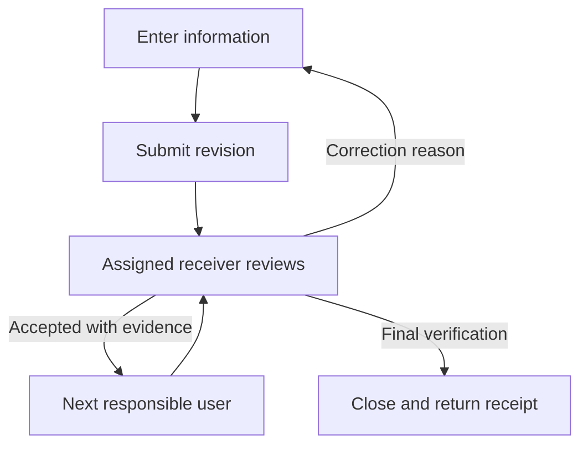

# User information, task handoffs and business completion

2026-10-22. Status: 15 candidate definitions, shared planning code and internal workflow execution services with tests. See [communications implementation](communications-implementation.md) for code, persistence and communication boundaries. These are not 15 newly registered or verified production business processes. Reconcile against the existing live catalogue before inserting definitions; reuse existing process IDs when they match.

## Common user journey

The user enters the required information and evidence references, saves a draft, and submits it. An authorized service validates the submission and assigns a named receiving user within the correct tenant and permitted responsibility. The receiver acknowledges the task, reviews the information and either accepts it, requests correction with a reason, or records a blocker. Corrections return to the original submitting user, retaining the original evidence and submission history. Resubmission creates a new revision. Accepted work moves to the next responsible user; the final step requires completion review and a receipt back to the originator.

This describes the intended live experience. The planner currently prepares evidence checks and handoff instructions only; it does not save, assign, approve, close or notify.

## Task flows

Responsibility names below are business duties, not new system roles or permission grants. Exact evidence keys and step identities are in packages/shared/src/business/task-flows.json.

| Flow | Information registered | Handoff | Completion evidence |
| --- | --- | --- | --- |
| Manager targets | Metric, target, period, currency, milestones | Sales lead → business lead → sales lead | Approved version and acknowledgement |
| Sales opportunity | Contact basis, source, territory interest, proposal, accepted agreement, value | Sales representative → sales lead → representative → commercial reviewer → finance | Verified close, customer reference and credit allocation |
| Tenant and territory launch | Verified close, business identity, tenant/admin, allocation, services, documents | Commercial reviewer → platform administration → territory administration → tenant administration → launch reviewer → operations | Launch approval and operating handover |
| Client service request | Client reference, contact basis, request, assessment, consent, approved plan | Intake → care supervisor → scheduler → supervisor → operations | Reviewed service handover |
| Service delivery | Assigned visit, approved plan, service record, exceptions | Scheduler → care worker → supervisor → finance | Reviewed service completion; billing eligibility remains separate |
| Invoice and receipt | Approved billing basis, invoice, amount/currency, payment/reconciliation references | Operations → finance → finance reviewer → sales lead | Separate contracted, invoiced and net-paid totals |
| Refund/cancellation | Original record, reason, evidence, adjustment | Requester → finance → reviewer → requester | Reconciled adjustment and corrected sales credit |
| Operations issue | Impact, observation time, triage, owner, deadline, recovery | Reporter → operations lead → action owner → reviewer → reporter | Verified recovery and follow-up |
| Emergency | Event, immediate action, containment, response owner, recovery | Reporter → emergency lead → response owner → independent reviewer → reporter | Verified resolution and recurrence action |
| Staff onboarding | Restricted person reference, position/scope, identity/credential/training checks | HR intake → HR reviewer → staffing lead → operations | Approved staffing readiness; no automatic clinical privileges |
| HR concern | Restricted case and safe-contact references, review, outcome | Reporter → HR triage → case owner → independent reviewer → HR triage | Restricted closure and controlled notification decision |
| Security/privacy incident | Restricted incident, impact, containment, remediation | Reporter → security/privacy lead → response owner → reviewer → lead | Verification and recorded notification decision |
| Compliance renewal | Document, requirement, expiry, gaps, replacement evidence | Record owner → compliance reviewer → owner → reviewer | Verified replacement and next review |
| Complaint/renewal risk | Customer concern, investigation, corrective action | Service team → quality lead → action owner → reviewer → service team | Resolution, customer response and follow-up |
| Business review | Approved targets, eligible actuals, source cutoff, flags/unknown coverage | Sales lead → business reviewer → action owner → reviewer → sales lead | Verified corrective action and next review |

## Information and control contract for live implementation

Every task needs a stable process/task ID, business-record reference, tenant scope, original submitting user, named assignee, authorized reviewer, status, version, evidence references, created/submitted/acknowledged timestamps, original/effective deadlines, next action and audit history. Record a policy version and evidence cutoff. Existing workforce accountability logic already distinguishes owner lateness, review backlog and non-employee blockers; reuse it rather than creating conflicting employee scoring.

Planned states: draft → submitted → assigned → acknowledged → in progress → awaiting review → accepted → closed. Return-for-correction, blocked and cancelled are explicit alternatives. A correction returns to the original user, even if the responsibility has multiple people. Reassignment requires an authorized replacement and audit; do not route a sensitive case to an unrestricted fallback. An unavailable original user requires an authorized substitution. Accepting one step does not silently approve every later step.

At submission, assignment, evidence attachment, read, review, export and closure, the service must enforce current permissions and tenant scope. The planner is not an authorization boundary. Responsibilities must map to existing registered role policies. An HR reference itself may be sensitive; never expose it to an unauthorized queue or broad dashboard. Supply only permitted aggregates to business flags.

Persist the transition, evidence version, audit and next-task/outbox event atomically. Enforce expected versions and idempotency keys in the registered service; handle retries without duplicate work. Preserve rejected submissions and reasons. Independent reviewers cannot approve their own work where policy requires separation. Verify actual downstream business records before closing; an entered reference alone is not proof.

Deadlines and escalations come from an approved policy/calendar. Preserve the original deadline; extensions require authority and a reason. Surface overdue acknowledgement, overdue review, blocked dependencies and unassigned work separately. Escalate to a permitted backup according to policy. Existing in-app growth alerts do not imply external delivery. Notification channels need their own registered permissions, destination controls and delivery evidence. No message is sent by this catalog.

Emergency response must start through the established emergency procedure immediately; data entry, missing fields and task acknowledgement must never delay it. Capture additional evidence afterwards. This generic catalog does not determine clinical urgency, employment outcomes or regulatory notification obligations.

## Code use and current gaps

BusinessTaskFlowBase in packages/shared/src/business/task-flow.ts validates candidate definitions, checks required evidence, prepares receiver instructions and plans correction/next-step handoffs. It defensively freezes its validated definition. The catalog and tests use the same class. It does not claim to verify a reference, authenticate users or execute side effects.

Existing source available for integration includes growth/tasks.ts (assignment/reschedule/escalation actions), growth/provisioning.ts (tenant activation), territories/service.ts (allocation), platform-bundle/attention.ts (support/documents/routing/launch), workforce/foundation.ts (accountability), and business/base.ts (flags). These are partial capabilities, not proof of this whole journey. Existing growth tasks do not establish a complete cross-department correction/review inbox. Finance receipts are not an implemented external payment gateway. Current Flutter forms and bindings remain unverified for these proposed flows.

Before any live exposure: map the candidate steps to pinned production governance workflows/APIs/screens/controls/permissions; resolve missing specifications; register missing entities through a production-compatible writer; complete required reviews; then implement persistence, assignee selection, evidence checks, current-client forms/inbox and permitted notifications. Preserve existing registration/test statuses until real evidence is recorded. Do not feed this candidate JSON to a live UI generator as if it were the production registry.

Acceptance must prove login → enter → submit → receiver queue → correction → resubmit → independent acceptance → next task → business record → reload → closure receipt. Include two users, forbidden/self-review actors, another tenant, duplicate/concurrent submissions, absent assignees, overdue review, failed delivery, HR confidentiality, responsive/accessibility/localization and database/audit checks. No live-user screenshot is available for these new flows yet.
